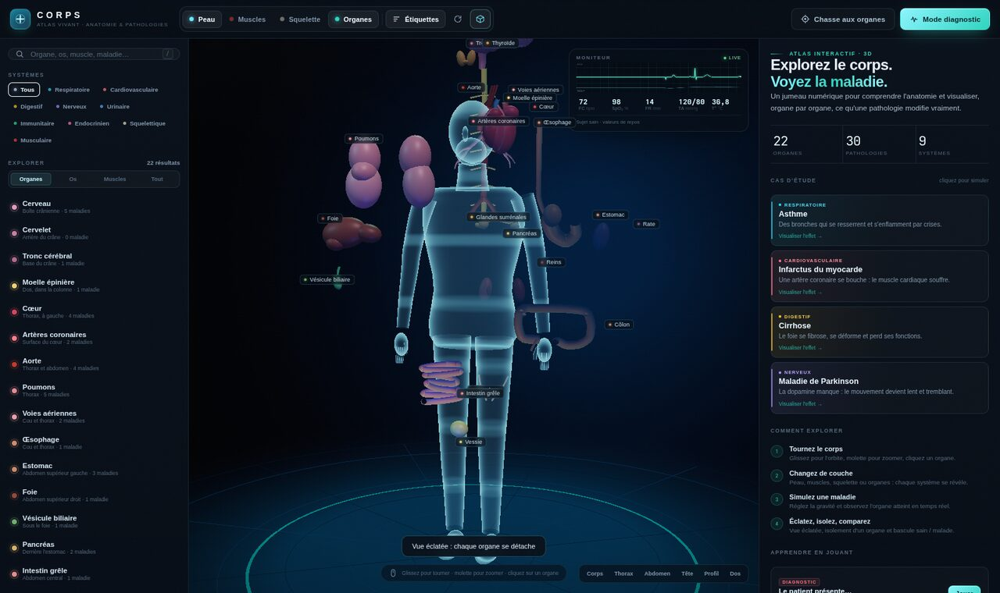
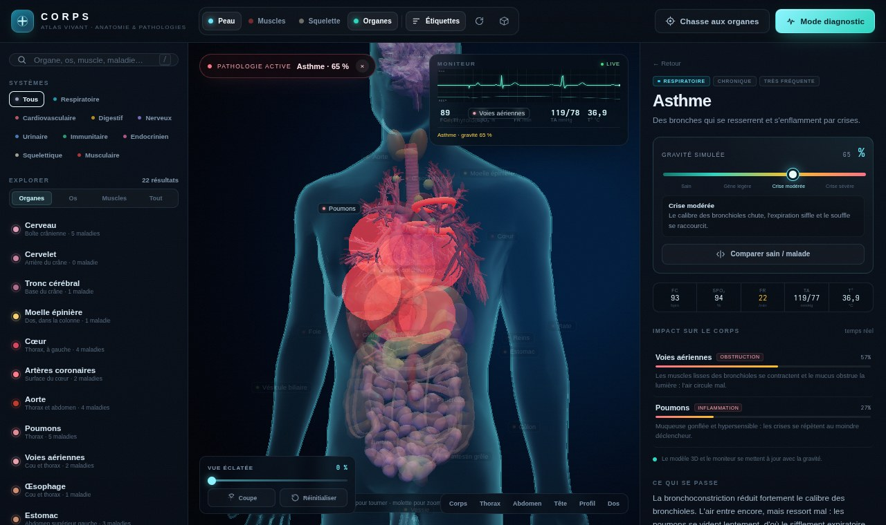

# CORPS — Atlas vivant du corps humain

Atlas 3D interactif en français pour explorer l'anatomie et visualiser l'effet des pathologies.
Construit avec **Three.js** et **Vite**, sans modèle anatomique externe : la silhouette, les organes,
les os et les muscles sont générés procéduralement.

**Application en ligne :** https://tasour.github.io/corps-humain/





## Fonctionnalités

- **22 organes**, **13 os**, **11 muscles** et **30 pathologies** répartis en 9 systèmes.
- Couches anatomiques : peau, muscles, squelette, organes, étiquettes.
- **Vue éclatée** : chaque organe se détache pour être observé séparément.
- **Isolement** : un seul organe à l'écran, avec cadrage automatique.
- **Comparaison sain / malade** : bascule instantanée entre l'état physiologique et la pathologie.
- Simulation de gravité en temps réel : morphologie, couleurs, halos, secousses, monitorage
  (FC, SpO₂, FR, TA, température) et ECG.
- Recherche, filtres par système, fiches détaillées (fonction, causes, symptômes, prévention).
- Deux jeux pédagogiques : **mode diagnostic** et **chasse aux organes**.
- **Installable sur mobile (PWA)** : icône dédiée, plein écran et accès hors ligne.
- Interface responsive desktop / mobile, sans dépendance à un backend.

## Lancer le projet

```bash
npm install
npm run dev      # http://localhost:5173
npm run build    # génère dist/
npm run preview  # prévisualise le build
```

Le build utilise `base: "./"`, il fonctionne donc à la racine comme dans un sous-dossier
(GitHub Pages, serveur statique, etc.).

## Installer sur téléphone (PWA)

L'application est une **Progressive Web App** : elle peut être installée depuis le navigateur,
sans passer par l'App Store ni le Play Store.

### Android / Chrome

1. Ouvrir https://tasour.github.io/corps-humain/
2. Appuyer sur le bouton **Installer** ou sur le menu **⋮** de Chrome.
3. Choisir **Installer l'application** (ou **Ajouter à l'écran d'accueil**).

### iOS / Safari

1. Ouvrir https://tasour.github.io/corps-humain/ dans **Safari**.
2. Appuyer sur le bouton **Partager**.
3. Choisir **Sur l'écran d'accueil**, puis **Ajouter**.

L'application s'ouvre ensuite en plein écran, avec son icône, et reste disponible
hors ligne après la première visite.

## Raccourci Omarchy

Pour ajouter l'application au lanceur Omarchy (Hyprland) :

```bash
bash packaging/install-launcher.sh
```

Le raccourci ouvre l'application hébergée en mode web-app, avec son icône et son nom dédiés.

## Structure

```
src/
  anatomy.js        géométrie procédurale (peau, organes, os, muscles)
  scene.js          moteur Three.js, couches, pathologies, vue éclatée, isolement
  main.js           état de l'application et interactions
  ui.js             rendu des panneaux et fiches
  games.js          mode diagnostic et chasse aux organes
  monitor.js        ECG et constantes vitales
  data/             pathologies et systèmes
  style.css         interface
```

## Sources & crédits

L'anatomie et les contenus sont originaux et générés pour ce projet. Les idées de
visualisation s'inspirent de projets libres :

- [ashemag/human-atlas](https://github.com/ashemag/human-atlas) — vue éclatée, isolement,
  comparaison sain / malade.
- [BodyParts3D · Z-Anatomy](https://github.com/Z-Anatomy/Models-of-human-anatomy) — référence
  de modélisation anatomique libre.
- [anatomyatelier.org](https://anatomyatelier.org/) — inspiration pédagogique.

## Avertissement

Outil pédagogique de visualisation. Il ne remplace ni un diagnostic ni un avis médical.
En cas de symptômes réels, consultez un professionnel de santé.

## Licence

Code sous licence MIT — voir [LICENSE](LICENSE).
